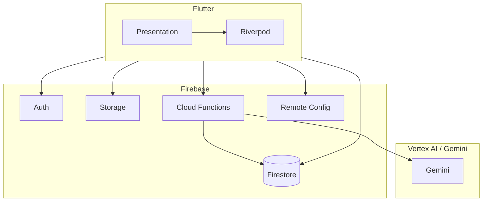

# GuardianRoute — System Architecture

Phase 0 architecture is captured in the engineering kickoff; Phase 1 implements the foundation described here.

## Overview

GuardianRoute is a Flutter mobile application backed by Firebase, with trusted business logic in Cloud Functions and Gemini for multimodal hazard analysis.

## Mobile structure

Feature-first layout under `mobile/lib/`:

- `app/` — bootstrap, theme, router
- `core/` — config, providers, shared services
- `features/` — authentication, onboarding, home (map shell), profile

## Phase 1 deliverables

- Material 3 theme and navigation (`go_router`)
- Firebase initialization, emulators, App Check (debug), Crashlytics, Analytics hooks, Remote Config defaults
- Google + anonymous authentication
- Callable `ensureUserProfile` and `ping` in Cloud Functions
- Firestore and Storage security rules (repository root `firebase/`)

## Next phases

See `docs/ROADMAP.md` and `GUARDIANROUTE_MASTER_PROMPT.md` §51.
